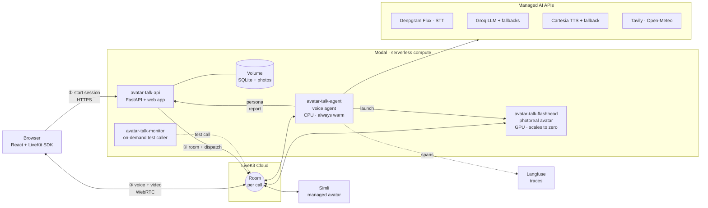
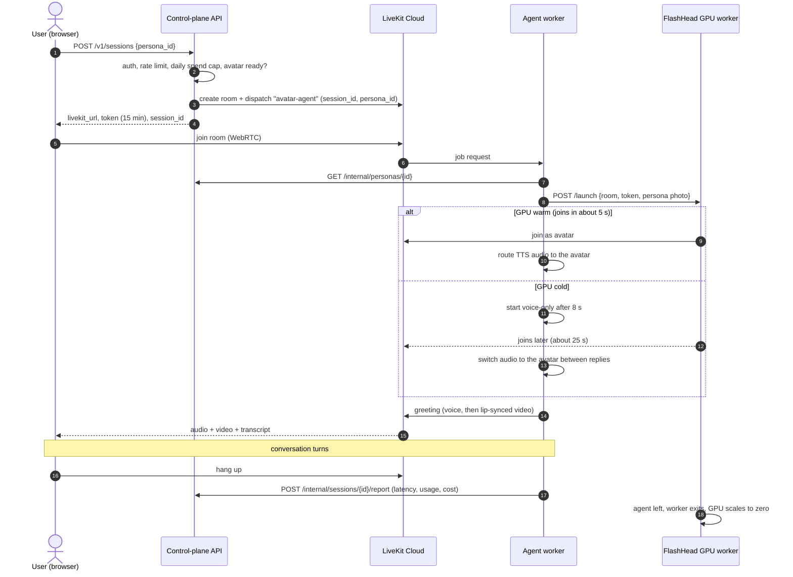
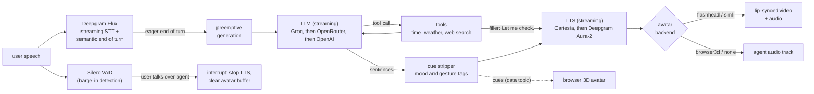
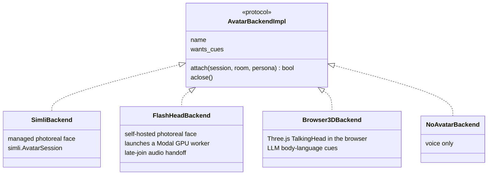
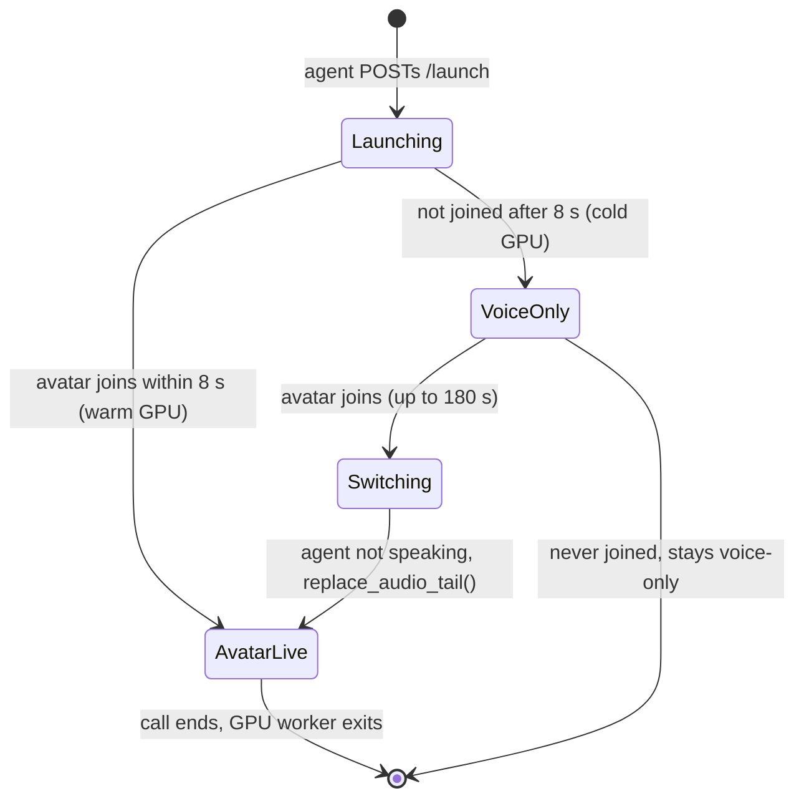
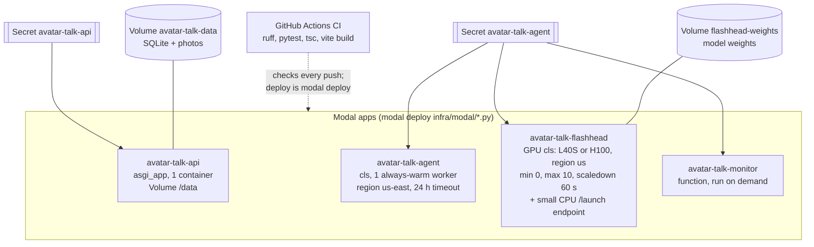
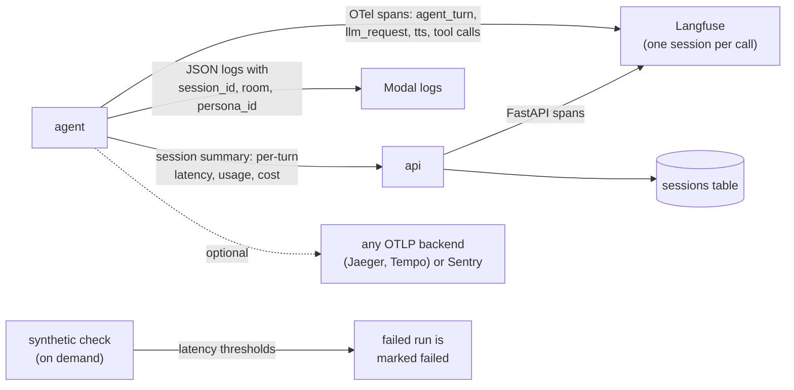

# Avatar Talk

A general-purpose **digital human** you talk to face to face in the browser. You pick a persona (or create one from a single photo), press call, and talk. It listens, thinks, uses tools (time, weather, web search), and answers with a voice and a lip-synced face, in real time, and you can interrupt it mid-sentence like a person.

It is a cloud-native system of small services: a serverless control-plane API, a fleet of real-time voice agents, and a GPU avatar renderer that scales to zero. They run on **Modal**, with **LiveKit Cloud** as the WebRTC media plane and managed AI APIs for speech and language.

- **Live demo:** `https://observer04--avatar-talk-api-web.us-east.modal.run` (needs a client API key, entered once in the page)
- **Project report:** [`docs/REPORT.md`](docs/REPORT.md)
- **Deploy runbook:** [`infra/modal/README.md`](infra/modal/README.md) · **API reference:** [`docs/api.md`](docs/api.md) · **Measurements:** [`docs/benchmarks.md`](docs/benchmarks.md)

## Architecture

### System overview

Three planes, kept separate so each can scale and fail on its own:

- **Control plane:** the API owns personas, photos, sessions, auth and spend limits. It never touches audio.
- **Media plane:** LiveKit Cloud carries all audio, video and data between the browser, the agent and the avatar, over WebRTC with a global edge and TURN.
- **Compute plane:** stateless agent workers (CPU) run the conversation; GPU workers render the face only while a call needs one.



### What happens when you press "Call"

The API creates a LiveKit room and **explicitly dispatches** an agent into it with the session metadata, then hands the browser a short-lived token. The agent loads the persona, attaches the avatar backend and greets you.



### One conversational turn

Latency is the product. Each stage streams into the next, nothing waits for a whole sentence, and every provider has a fallback.



Measured on the deployed stack (agent in Modal `us-east`, voice only): the agent starts answering **1.4–1.9 s** after you stop talking, a tool turn plays its filler in **1.2–2.0 s**, and barge-in silences it in **1.2–1.4 s** as heard by the caller. Details in [`docs/benchmarks.md`](docs/benchmarks.md).

### Swappable avatars behind one interface

A persona chooses its face. Every backend implements `attach(session, room, persona)`, so the agent code does not change when a renderer is added.



| Backend | Where it runs | From one photo | Video | Added per-turn latency | Cost |
| --- | --- | --- | --- | --- | --- |
| `flashhead` | our Modal GPU (SoulX-FlashHead Lite, L40S) | yes | 25 fps, 512×512 | ~3–4 s | ~$2.71/h while in a call, $0 idle |
| `simli` | Simli (managed) | yes (paid plan) or preset faces | ~23–25 fps, 768×768 | ~0.7–1.0 s | ~$0.05/min |
| `browser3d` | the user's browser (Three.js) | no (3D character) | rendered locally | none | $0 |
| `none` | – | – | – | none | $0 |

The FlashHead GPU worker never leaves the user waiting: if the GPU is cold, the call starts voice-only and the agent moves its audio to the face when it joins. A worker that starts after the call has ended leaves within 30 s instead of holding a GPU.



### Deployment on Modal

All infrastructure is Python code in [`infra/modal/`](infra/modal/): images, hardware, scaling, regions, secrets and volumes are declared next to the code that uses them.



| Cloud feature | How it is used |
| --- | --- |
| Serverless containers | API, agent and monitor are Modal functions and classes built from code-defined images |
| Autoscaling and scale to zero | GPU avatar workers start per call and stop 60 s after it; up to 10 concurrent sessions |
| GPU acceleration with fallback | `gpu=["L40S", "H100"]` in any US region, so a call isn't stuck waiting for one GPU type |
| Region placement | the agent is pinned to `us-east` next to Deepgram, Groq and Cartesia (plain turn 2.21 s from the EU vs 1.40–1.82 s from us-east) |
| Persistent storage | Modal Volumes for the SQLite database and photos, and for the 1.3B-parameter model weights |
| Secrets management | Modal Secrets per service, created from JSON files so values never appear on a command line |
| Synthetic checks | an on-demand scripted caller (`modal run infra/modal/monitor_app.py`) measures latency and fails loudly on regressions; it has no schedule, to save credits |
| Managed media (PaaS) | LiveKit Cloud SFU, TURN and explicit agent dispatch |
| Observability (SaaS) | OpenTelemetry traces to Langfuse, JSON logs with correlation IDs, per-session cost reports |

### Observability



## Repository layout

```
packages/core/             avatar_core: shared settings, Persona/Session schemas, telemetry, logging, cost model
services/agent/            LiveKit Agents worker: pipeline, persona agent, tools, avatar backends, observability
  scripts/synthetic_call.py  headless caller for e2e tests, benchmarks and the monitor
services/api/              FastAPI control plane: personas, photos, sessions, auth, spend cap (SQLAlchemy + Alembic)
services/avatar_flashhead/ GPU avatar worker: FlashHead model wrapper, video generator, LiveKit runner, launcher
web/                       React + LiveKit components: persona gallery, create persona, call view, transcript
infra/modal/               Modal apps (api, agent, flashhead, monitor) and the deploy runbook
infra/docker-compose.dev.yml  local Postgres + Jaeger
docs/                      report, API reference, benchmarks, FlashHead GPU spike
legacy/phase0/             first prototype (Pipecat, local CPU models, 3D avatar)
```

## Run it

### Prerequisites

- [uv](https://docs.astral.sh/uv/) with Python 3.13, and Node 20+
- Keys: LiveKit Cloud, Deepgram, Cartesia and Groq are required. OpenRouter or OpenAI (LLM fallbacks), Tavily (web search), Langfuse (traces), Simli (managed avatar) and Modal (cloud deploy) are optional.

### Locally

```bash
uv sync --all-packages                  # Python workspace (core, agent, api)
cp .env.example .env                    # fill in the keys
uv run uvicorn api.main:app --port 8000 # control-plane API (creates the SQLite DB on start)
uv run python -m agent.main dev         # agent worker, registers with LiveKit Cloud
cd web && npm install && npm run dev    # http://localhost:5173 (proxies /v1 to :8000)
```

Leave `API_KEYS` empty for local use (no auth), or set it and paste the key when the page asks. A local agent registers with LiveKit under the same name as the cloud one, so run `infra/modal/demo.sh off` first if the cloud agent is deployed, or calls may go to either. `npm run mock` in `web/` serves a stand-in API for UI work without any keys.

### On the cloud (Modal), first time

You need a Modal account (`pip install modal && modal setup`) and the keys above. The order matters because the agent's secret needs the URLs of the API and the FlashHead launcher, which exist only after those apps are deployed.

1. **Generate two shared tokens** (keep them; they go into both secrets and your `.env`):

   ```bash
   python -c "import secrets; print('INTERNAL_API_TOKEN', secrets.token_urlsafe(32)); print('AVATAR_API_KEY', secrets.token_urlsafe(24))"
   ```

2. **Create the API secret** from a JSON file (delete the file afterwards):

   ```json
   {"LIVEKIT_URL": "wss://<project>.livekit.cloud", "LIVEKIT_API_KEY": "...", "LIVEKIT_API_SECRET": "...",
    "INTERNAL_API_TOKEN": "<token>", "API_KEYS": "<AVATAR_API_KEY>", "CORS_ORIGINS": "*",
    "SIMLI_API_KEY": "", "ENVIRONMENT": "prod"}
   ```

   ```bash
   modal secret create avatar-talk-api --from-json api.json
   ```

3. **Deploy the API and web app**, and note the URL it prints:

   ```bash
   (cd web && npm ci && npm run build) && modal deploy infra/modal/api_app.py
   ```

4. **Optional, for the photoreal FlashHead avatar:** download the model weights into a Modal volume once (about 10 minutes), then deploy the GPU worker and note its `...-web.modal.run` URL:

   ```bash
   modal run services/avatar_flashhead/spike/bench_modal.py::download
   modal deploy infra/modal/flashhead_app.py
   ```

5. **Create the agent secret** with the URLs from steps 3 and 4:

   ```json
   {"LIVEKIT_URL": "wss://<project>.livekit.cloud", "LIVEKIT_API_KEY": "...", "LIVEKIT_API_SECRET": "...",
    "DEEPGRAM_API_KEY": "...", "CARTESIA_API_KEY": "...", "GROQ_API_KEY": "...",
    "OPENROUTER_API_KEY": "", "OPENAI_API_KEY": "", "TAVILY_API_KEY": "", "SIMLI_API_KEY": "",
    "LANGFUSE_HOST": "https://cloud.langfuse.com", "LANGFUSE_PUBLIC_KEY": "", "LANGFUSE_SECRET_KEY": "",
    "API_URL": "<URL from step 3>", "INTERNAL_API_TOKEN": "<token>", "AVATAR_API_KEY": "<AVATAR_API_KEY>",
    "FLASHHEAD_LAUNCH_URL": "<URL from step 4, or empty>"}
   ```

   ```bash
   modal secret create avatar-talk-agent --from-json agent.json
   modal deploy infra/modal/agent_app.py
   ```

6. **Open the API URL** in a browser, paste `AVATAR_API_KEY` when asked, create a persona and press Call. To check the stack from the command line instead: `modal run infra/modal/monitor_app.py` (one scripted test call, about $0.02).

7. **Turn it off when you're done:** `infra/modal/demo.sh off` (see below).

If Modal commands fail with a malformed-token error, a stale `MODAL_TOKEN_ID`/`MODAL_TOKEN_SECRET` in your shell is overriding `~/.modal.toml`; unset them. Changing a key later means re-creating the secret with all values and redeploying the app that uses it. The full runbook (regions, logs, keep-warm, costs) is in [`infra/modal/README.md`](infra/modal/README.md).

### Demo on/off switch

Turn the deployed demo on before showing it and off afterwards so idle workers don't use credit:

```bash
infra/modal/demo.sh on            # deploy anything missing, keep 1 agent worker + 1 FlashHead GPU warm, check health
infra/modal/demo.sh on --no-gpu   # same without the GPU (photoreal face takes ~25 s to appear on the first call)
infra/modal/demo.sh on --check    # also place one scripted test call (~$0.02)
infra/modal/demo.sh status        # what is running and roughly what it costs per hour
infra/modal/demo.sh off           # scale everything to zero (--dry-run to preview)
```

While on it costs about $2.84/hour with the warm GPU, or $0.13/hour without it, plus per-call usage. When off, nothing runs; the API wakes only if someone opens the URL.

### Tests and a synthetic call

```bash
uv run pytest -q            # 55 tests: core, agent, api, FlashHead worker
uv run ruff check .
cd web && npx tsc --noEmit -p tsconfig.app.json && npm run build

# A scripted caller joins a room, asks a tool question and a plain one, interrupts, and prints latency:
uv run python services/agent/scripts/synthetic_call.py --persona-id <per_...> \
    --api-url https://observer04--avatar-talk-api-web.us-east.modal.run --api-key "$AVATAR_API_KEY"
```

## Configuration

All settings are environment variables (Modal Secrets in the cloud, `.env` locally); see [`.env.example`](.env.example). Each persona also carries its own STT, LLM, voice, avatar backend and tools, so one deployment can host very different digital humans.

## Status and limits

- Voice-only turns take 1.4–1.9 s end to end; the original target was 1.2 s.
- FlashHead adds ~3–4 s per turn (0.96 s audio chunks plus frame pacing); Simli adds ~0.7–1.0 s.
- A cold FlashHead GPU shows its face ~25 s into a call (voice-only until then).
- Custom Simli faces need a paid Simli plan; Simli's preset faces work on the free tier.
- The API uses SQLite on a Modal Volume (single writer). The code also supports Postgres and S3 (`DATABASE_URL`, `STORAGE_BACKEND=s3`) for scaling out.
- The FlashHead weights licence must be reviewed before any commercial use.
