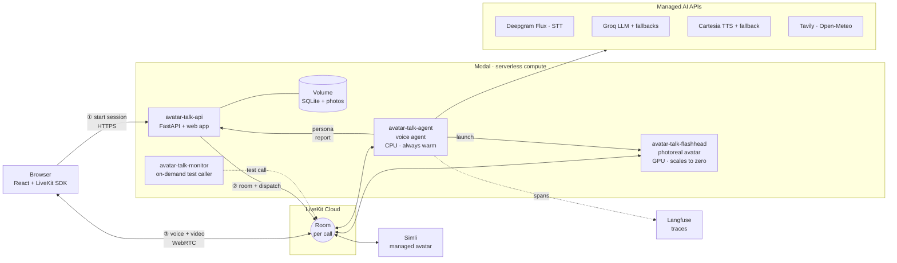
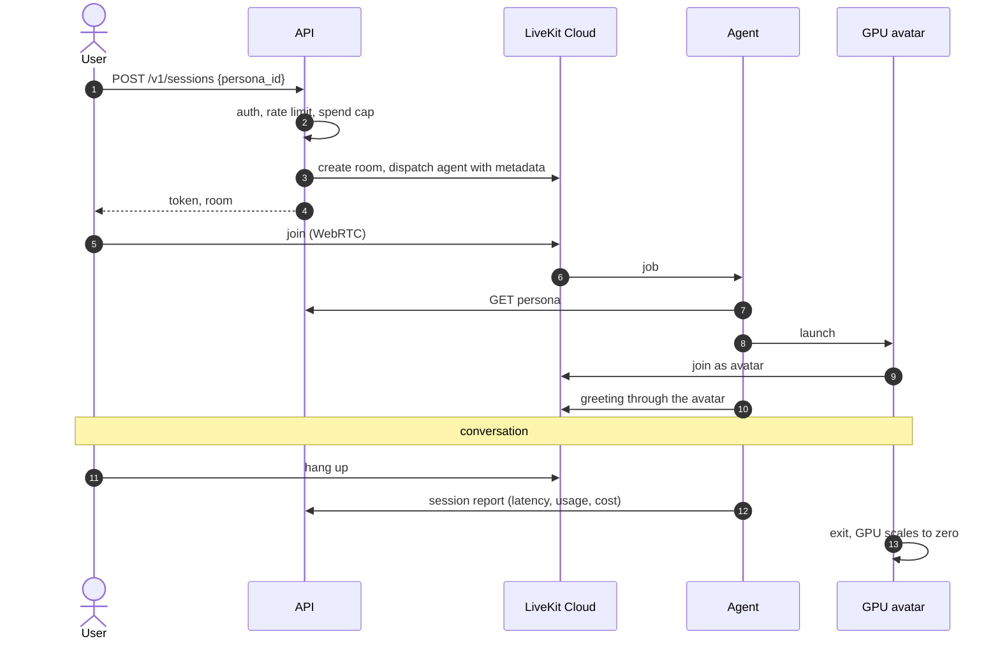
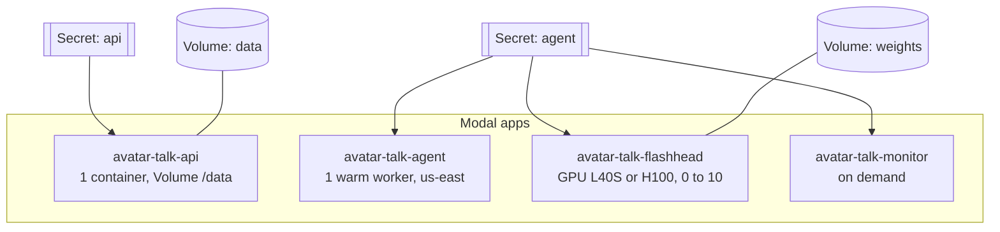

# Avatar Talk: A Cloud-Native Real-Time Digital Human

**Course:** [Course name and code] · **Instructor:** [Instructor name] · **Date:** [Submission date]

| Group member | Roll number |
| --- | --- |
| Omm Prakash Tripathy | B123082 |
| Vipul Choudhary | B123152 |
| Swayam Sarans Behera | B123144 |

**Source code:** https://github.com/observer04/avatar-talk · **Live deployment:** `https://observer04--avatar-talk-api-web.us-east.modal.run` · **Demo video:** [video link]

## Abstract

Avatar Talk is a "digital human": a conversational agent that people talk to by voice in a web browser and that answers with a natural voice and an animated, lip-synced face. A persona can be created from a single photograph. The system is built as cloud-native microservices on the Modal serverless platform, uses LiveKit Cloud as a managed WebRTC media plane, and composes managed AI services for speech recognition (Deepgram), language (Groq), speech synthesis (Cartesia) and photoreal avatars (Simli or a self-hosted SoulX-FlashHead model on cloud GPUs). The deployed system answers in 1.4–1.9 s after the user stops speaking, can be interrupted mid-sentence, renders a photoreal face at 25 fps on a GPU that is only paid for while a call is running, and reports latency, usage and cost for every session. This report describes the problem, objectives, architecture, cloud services, implementation, measured results and lessons learned.

## 1. Problem statement

Text chatbots are now common, but talking face to face is still the most natural interface for many people: for customer support, tutoring, companionship, accessibility, or simply people who do not type comfortably. Building a convincing real-time digital human is hard for three reasons:

1. **Latency.** Humans expect a reply within about one to two seconds of finishing a sentence. Speech recognition, a large language model, speech synthesis and video generation each add delay, and they run on different machines across the internet.
2. **Compute cost.** Photoreal talking-face generation needs a GPU. Keeping GPUs running all day for occasional conversations is expensive for a student or a small team.
3. **Operational complexity.** Real-time audio and video need WebRTC infrastructure (media servers, TURN relays, global edges), and the many moving parts need monitoring, cost limits and graceful failure.

The problem this project addresses is: **how to build and deploy a real-time, interruptible, photoreal digital human on public cloud services, with a small budget, in a way that is modular enough to keep adding capabilities.**

## 2. Objectives

1. Let a user hold a natural spoken conversation with a persona in the browser, with replies starting within about 2 seconds and the ability to interrupt (barge-in).
2. Give personas a face: a photoreal video avatar created from **a single photo**, with a cheap 3D fallback.
3. Make it a **general-purpose** assistant with tools (current time, weather, web search) and a plug-in mechanism for more.
4. Deploy everything on **public cloud** services with **serverless scaling**: no idle servers except one warm voice worker, and GPUs that **scale to zero**.
5. Keep the design **modular**: separate services, swappable providers (STT, LLM, TTS, avatar) behind interfaces, so new microservices can be added later.
6. Build in **observability, security and cost control** from the start: tracing, structured logs, per-session cost, API keys, rate limits and a daily spend cap.
7. Stay within a student budget by preferring open-source models and free or low-cost tiers.

## 3. Approach and evolution

The project went through two phases.

**Phase 0 (prototype).** A single Python process using the Pipecat framework with local CPU models (Moonshine speech recognition, Kokoro speech synthesis), the Groq free tier for the language model, and a 3D avatar rendered in the browser (TalkingHead and Three.js) with lip-sync computed from the audio. It cost almost nothing and replied in about 1.9–2.1 s, but speech recognition quality was poor, it ran on one laptop, and it had no photoreal face. This code is kept in `legacy/phase0/`.

**Phase 1 (this submission).** A rebuild as cloud microservices:

- **LiveKit Agents** replaced Pipecat, with LiveKit Cloud as the media plane.
- **Managed speech services** replaced local models: Deepgram Flux for speech recognition (it also decides when the user has finished a turn) and Cartesia Sonic-3 for speech synthesis.
- **Two photoreal avatar paths** sit behind one interface: Simli (managed) and SoulX-FlashHead (open-source, self-hosted on Modal GPUs).
- **Modal** hosts everything: the API, the voice agents, the GPU avatar workers and an on-demand test caller.

Two independent model recommendations (in `docs/gemini_recommendation.md` and `docs/gpt_recommendation.md`) were reviewed at the start to choose the components.

## 4. System architecture

### 4.1 Overview

The system is split into three planes so that each scales and fails independently:

- **Control plane:** the REST API (personas, photos, sessions, authentication, spend limits). It never handles audio.
- **Media plane:** LiveKit Cloud routes all real-time audio, video and data between browser, agent and avatar over WebRTC.
- **Compute plane:** stateless agent workers run the conversation on CPU; GPU workers render a face only during calls that need one.



### 4.2 Components

| Component | Technology | Responsibility |
| --- | --- | --- |
| Web app (`web/`) | React 19, LiveKit components, Three.js TalkingHead | Persona gallery, create a persona from a photo, call screen with video or 3D avatar, live transcript |
| Control-plane API (`services/api/`) | FastAPI, SQLAlchemy (async), Alembic, Pillow | Persona CRUD, photo upload and normalisation (512×512 face crop), avatar provisioning, session start (room creation, agent dispatch, 15-minute access token), session reports, auth, rate limit, daily spend cap |
| Voice agent (`services/agent/`) | LiveKit Agents 1.8 | Speech pipeline, persona prompt, tools, avatar backend, metrics, cost accounting, tracing |
| GPU avatar worker (`services/avatar_flashhead/`) | SoulX-FlashHead 1.3B (Lite), PyTorch, flash-attention, LiveKit | Joins the call, receives the agent's speech audio, generates lip-synced 512×512 video at 25 fps, publishes synchronised audio and video |
| Shared core (`packages/core/`) | Pydantic, OpenTelemetry | Settings, Persona and Session schemas, structured logging with correlation IDs, telemetry setup, cost model |
| Infrastructure (`infra/modal/`) | Modal Python SDK | Images, hardware, scaling, regions, secrets and volumes for the four apps |

### 4.3 Session flow



### 4.4 The real-time pipeline

Each turn streams through the stages without waiting for complete results:

1. The browser publishes microphone audio to the room.
2. **Deepgram Flux** transcribes it as it arrives and signals the end of the user's turn from the meaning of the sentence, not just silence. An early ("eager") end-of-turn signal starts **preemptive generation**: the language model and speech synthesis begin before the turn is confirmed.
3. The **language model** (Groq `gpt-oss-120b`, with OpenRouter and OpenAI as fallbacks) streams its answer. If it calls a tool, the agent immediately says a short filler ("Let me check.") so the user is not left in silence.
4. Body-language tags such as `[mood:happy]` are stripped from the text before speech; for the 3D avatar they are sent to the browser on a data channel instead.
5. **Cartesia Sonic-3** turns sentences into speech as they arrive (Deepgram Aura-2 takes over if Cartesia fails).
6. The audio goes to the **avatar backend**: for photoreal avatars it is streamed to the avatar participant, which publishes lip-synced audio and video; otherwise the agent publishes it directly.
7. **Silero VAD** keeps listening while the agent speaks. If the user talks over it, the agent stops speaking and the avatar's buffered frames are cleared (barge-in).

### 4.5 Design decisions

| Decision | Alternatives considered | Reason |
| --- | --- | --- |
| LiveKit Agents + LiveKit Cloud | Pipecat + Daily, custom WebRTC | Production media infrastructure (SFU, TURN, global edge) as a managed service; built-in agent dispatch, avatar data streams and turn handling |
| Modal for all compute | AWS ECS/Lambda, Azure Container Apps, GCP Cloud Run | One platform for CPU services, GPUs with per-second billing and scale-to-zero, on-demand jobs, volumes and secrets, all defined in Python; free credit available |
| Explicit agent dispatch with metadata | automatic dispatch | The API decides which persona joins which room, and the agent receives the session ID for tracing and reporting |
| Two photoreal avatar paths behind one interface | a single vendor | Simli is fast to integrate; FlashHead is open source with no per-minute fee; the interface allows adding more |
| Groq `gpt-oss-120b` as the default LLM | OpenAI `gpt-4.1-mini`, Groq `gpt-oss-20b` | Lowest measured time to first token (0.46–0.70 s) and cheapest; fallbacks keep the call alive if Groq fails |
| Agent pinned to `us-east` | default placement (Europe) | Measured plain-turn latency fell from 2.21 s to 1.40–1.82 s next to the AI providers |
| FlashHead Lite, eager mode, L40S with H100 fallback | Pro model, compiled mode, A10 | Lite reaches 25 fps with large headroom; compiled mode needs a 40–190 s warm-up; A10 is too slow; a single GPU type can queue for minutes |

## 5. Cloud services used

| Service | Category | What it provides here | Tier and cost |
| --- | --- | --- | --- |
| **Modal** | Serverless compute (CaaS/PaaS) | Four apps: an ASGI web endpoint for the API and static web app; an always-warm CPU class for the voice agent; a GPU class (L40S, H100 fallback) for avatars that scales to zero; an on-demand function for synthetic test calls. Also container image builds, Volumes, Secrets, logs and region selection | Pay per second; covered by about $100 of credit |
| **Modal Volumes** | Persistent storage | `avatar-talk-data` holds the SQLite database and persona photos; `flashhead-weights` holds the model weights so containers never download them | Included |
| **Modal Secrets** | Secrets management | Per-service credentials injected as environment variables | Included |
| **Modal Functions (on demand)** | Synthetic checks | A scripted test call with latency thresholds, run with `modal run`; a failed run is marked failed | ~$0.02 per run |
| **LiveKit Cloud** | Managed real-time media (PaaS) | WebRTC SFU, TURN, global edge, rooms, agent dispatch, data streams | Free tier |
| **Deepgram** | AI API (SaaS) | Flux streaming speech recognition with turn detection; Aura-2 fallback voice | ~$0.0077 per audio minute |
| **Groq** | AI API (SaaS) | `gpt-oss-120b` language model on LPU hardware | ~$0.15 / $0.60 per million input / output tokens |
| **OpenRouter, OpenAI** | AI API (SaaS) | Fallback language models | Pay as you go |
| **Cartesia** | AI API (SaaS) | Sonic-3 streaming speech synthesis | ~$0.04 per 1,000 characters |
| **Simli** | AI API (SaaS) | Managed photoreal avatar | Free minutes; ~$0.05 per minute |
| **Tavily, Open-Meteo** | APIs | Web search and weather tools | Free tiers |
| **Langfuse Cloud** | Observability (SaaS) | OpenTelemetry trace storage and UI, one session per call | Free tier |
| **GitHub Actions** | CI | Lint, tests, type check and web build on every push | Free for public repos |

Cloud computing concepts this demonstrates:

- **Serverless and autoscaling:** containers start on demand; the GPU pool goes from 0 to as many as 10 workers.
- **Scale to zero:** GPUs cost nothing between calls.
- **Accelerated computing** with hardware fallback.
- **Region placement** for latency.
- **Infrastructure as code:** all infrastructure is defined in Python next to the code that uses it.
- **Managed services at every layer:** PaaS for media, SaaS for AI and observability.
- **Secrets management.**
- **Health checks and synthetic monitoring.**
- **Cost governance:** per-session cost accounting, a daily spend cap, scale to zero, and a demo on/off switch that stops everything that costs money while idle.

### 5.1 Deployment topology



| App | Resources | Scaling |
| --- | --- | --- |
| `avatar-talk-api` | 1 vCPU, 1 GB | 1 container (single SQLite writer); the volume is committed after each write |
| `avatar-talk-agent` | 2 vCPU, 4 GB, `us-east` | 1 always-warm worker; LiveKit balances calls across registered workers; raise `min_containers` for more capacity |
| `avatar-talk-flashhead` | L40S (H100 fallback), 8 vCPU, 48 GB, any US region | 0 to 10 containers, one per call; 60 s scale-down; optional keep-warm |
| `avatar-talk-monitor` | CPU | on demand (`modal run`) |

## 6. Implementation

### 6.1 Control-plane API

- **Personas:** created with `POST /v1/personas`. Each persona carries its own speech recognition, language model, voice, avatar backend, tools and system prompt, so one deployment can host very different characters.
- **Photos:** uploaded with `PUT /v1/personas/{id}/photo`, checked (type, maximum 10 MB), and normalised with Pillow into a 512×512 crop biased towards the face.
  - For Simli the API submits the photo to Simli's face-generation endpoint and tracks the status (`provisioning`, then `ready` or `failed`).
  - For FlashHead the photo is used directly at call time.
- **Sessions:** `POST /v1/sessions` does the following:
  1. Checks the client API key, the per-key rate limit (60 per minute), whether the avatar is ready (409 if not), and the daily spend cap (429 if exceeded).
  2. Creates a LiveKit room and explicitly dispatches the `avatar-agent` with the session metadata.
  3. Returns a 15-minute access token.
- **Internal routes:**
  - `GET /internal/personas/{id}` returns the persona to the agent.
  - `POST /internal/sessions/{id}/report` stores the agent's end-of-call report.
  - Both require a separate service token.
- **Storage:** SQLAlchemy with async drivers works with SQLite (current deployment) or Postgres (one environment variable) and is migrated with Alembic. Photo storage is local or S3 behind one interface.

### 6.2 Voice agent

- **Startup:** the worker registers with LiveKit Cloud and pre-loads the voice activity model.
- **Each call:**
  1. Parse the dispatch metadata.
  2. Load the persona from the API.
  3. Bind correlation IDs (`session_id`, `room`, `persona_id`) to every log line.
  4. Start tracing with the session ID.
  5. Build the speech-to-text, language-model and text-to-speech chain from the persona, each wrapped in a fallback adapter.
  6. Attach the avatar backend.
  7. Start the session.
- **Tools** are plain Python functions registered per persona (`get_current_time`, `get_weather`, `search_web`); slow tools speak a filler first. New tools are a module in `agent/tools/`.
- **Avatar backends** implement one protocol: `attach(session, room, persona)` and `aclose()`.
  - `SimliBackend` uses LiveKit's Simli plugin.
  - `Browser3DBackend` sends body-language cues to the browser.
  - `FlashHeadBackend` does three things:
    - It mints a LiveKit token for the avatar participant and calls the GPU app's `/launch` endpoint.
    - It routes the agent's speech audio to that participant.
    - It handles cold GPUs: it waits 8 s for a warm worker, otherwise starts voice-only, and when the avatar joins later it moves the audio to it between replies (`replace_audio_tail`), so the user never waits or sees a silent face.
- **Observability:** each turn's metrics (end-of-turn delay, LLM time to first token, TTS time to first byte, end-to-end latency, interruption) are logged, exported as OpenTelemetry metrics, and summarised with usage and estimated cost in a session report sent to the API.

### 6.3 GPU avatar worker

The worker wraps SoulX-FlashHead (a 1.3-billion-parameter audio-driven talking-head model).

- **Container start:** loads the model once from the weights volume.
- **Per call:** fetches the persona photo, prepares it (one VAE encode, 0.4 s), warms up, and joins the call as an agent-kind participant publishing on behalf of the voice agent.
- **Video generation:** a custom `VideoGenerator` buffers 16 kHz speech audio into 0.96 s chunks, generates 24 frames per chunk (0.17–0.36 s on an L40S), and paces output at 25 fps with idle motion between replies.
- **Publishing:** an audio/video synchroniser publishes both tracks with NVENC H.264 encoding at up to 1.5 Mbps. The video frame capture runs in a thread so encoder back-pressure does not stall the event loop.
- **Interruptions:** the agent's `clear_buffer` call drops queued audio and frames immediately.
- **Lifecycle safety:** the worker exits when the agent leaves, and also if the agent is not in the room within 30 s. The second case covers a launch that waited in the GPU queue until after the call ended, so it cannot hold a GPU for the one-hour container timeout.

### 6.4 Web application

The React application lists personas, creates a persona with a photo and a voice picker, and runs the call view.

- **Avatar display:**
  - When a video avatar joins, its video is shown.
  - For 3D personas, the TalkingHead avatar is lip-synced from the agent's audio in the browser.
  - While a photoreal avatar is warming up, the persona photo pulses with the voice.
- **Transcript:** live, read from LiveKit transcription streams.
- **Production build:** served by the API container from the same origin.
- **Authentication:** the client API key is entered once and kept in the browser's local storage, never compiled into the public bundle.

### 6.5 Security and cost controls

- **Authentication:** client API keys (Bearer) and a separate internal service token; keys are compared in constant time, live only in Modal Secrets, and sessions record a hash of the key rather than the key itself.
- **Limits:**
  - 60 requests per minute per key.
  - A daily spend cap (default $20) computed from session reports.
  - A maximum session length per persona (15 minutes).
  - LiveKit tokens valid for 15 minutes and scoped to one room.
- **Input validation:** photo type and size are checked, and the image is re-encoded. CORS is limited to the configured origins.
- **Secrets hygiene:** secrets are created from JSON files and never passed on a command line. No keys are in the repository; the full git history was scanned before publishing.
- **Privacy:** prompt and transcript capture in traces can be switched off (`TRACE_CONTENT=false`).
- **GPU spend:** GPUs are released 60 s after a call, and stale launches are stopped after 30 s.

### 6.6 Testing and CI

- **Unit tests:** 55 Python tests with pytest. They cover the schemas and cost model, the cue parser, provider selection, persona loading, every API route against a test database, the FlashHead video generator (buffering, pacing, interruption, including a regression test for a crash found in production), the late-join audio hand-off, and the stale-launch guard.
- **Synthetic caller:** `services/agent/scripts/synthetic_call.py` is a headless end-to-end test. It joins a real room as a user and speaks synthesised questions: a tool question, a plain question, and an interruption. It measures what the user would hear (time to the agent's first audio, barge-in time, avatar video frame rate) and checks transcripts.
- **Synthetic check:** the same script runs on Modal against production on demand. It first ran every three hours, but each run used about 800 TTS characters (a third of a free Cartesia plan per day), so the schedule was removed.
- **CI:** GitHub Actions runs ruff, pytest, the TypeScript type check and the production web build.

## 7. Results

All numbers come from the synthetic caller against the deployed system unless noted. "Heard" latency is measured at the listener, from the end of the user's speech to the first audible agent audio, so it includes network transit through LiveKit Cloud twice.

### 7.1 Conversation latency (voice only)

| Metric | Result |
| --- | --- |
| Join to greeting | 2.5–4.3 s |
| Plain question: end of speech to first audio | **1.40–1.86 s** |
| Tool question: end of speech to filler audio | 1.21–1.95 s |
| Barge-in: user starts talking to agent silent | **1.17–1.37 s** |
| Agent-side end-to-end latency (LiveKit metric) | 0.55–1.85 s per turn |
| LLM time to first token (Groq `gpt-oss-120b`) | 0.18–0.70 s |
| TTS time to first byte (Cartesia) | 0.13–0.24 s |

Effect of cloud region on a plain turn: **2.21 s** with the agent in Europe (default placement) versus **1.40–1.82 s** pinned to `us-east`, next to the AI providers.

Language-model comparison (Spike B, plain question, heard latency): Groq `gpt-oss-120b` 2.5–3.0 s, Groq `gpt-oss-20b` 4.0 s, OpenRouter `gpt-4.1-mini` 4.2 s, all measured from a laptop agent. Groq `gpt-oss-120b` was chosen as the default.

### 7.2 Photoreal avatars

| Metric | Simli (managed) | FlashHead (our GPU, warm) | FlashHead (cold GPU) |
| --- | --- | --- | --- |
| Join to greeting | 4.8–5.9 s | 7.98 s | ~10 s (voice-only first) |
| Face appears | 4.4–5.7 s after join | with the greeting | ~25 s after the session starts |
| Tool turn to first audio | 1.90–2.32 s | 4.5–4.8 s | 4.5 s |
| Plain turn to first audio | 2.5–2.9 s | 5.6 s | 6.7 s |
| Barge-in | 1.57 s | 2.03 s | 2.13 s |
| Video | 23–25 fps, 768×768 | 25 fps, 512×512 | 24.7 fps, 512×512 |

FlashHead GPU benchmark (Spike A):

- **Speed:** the Lite model generates 0.96 s of video in 0.17–0.36 s, which is 66.8 fps eager on one L40S and 4 concurrent real-time streams per GPU.
- **Model start:** loading the model, preparing the photo and warming up takes about 4 s once a container is running.
- **Cold-start cause:** with a single GPU type in a single region, getting an L40S took up to 2 min 18 s in the queue. Allowing L40S or H100 in any US region cut the time to the face to about 25 s.

### 7.3 Cost

| Item | Cost |
| --- | --- |
| Voice-only conversation (STT, LLM, TTS) | ≈ $0.02–0.03 per minute |
| Simli avatar | ≈ $0.05 per minute |
| FlashHead avatar | ≈ $0.045 per minute at one stream per L40S ($2.71 per hour all-in); $0.68 per stream-hour at 4 streams per GPU |
| Idle cost | one CPU agent worker; GPUs cost $0 between calls |
| Synthetic check | ≈ $0.02 per run, on demand only |

Every session report includes its own estimated cost broken down by service, and the API refuses new sessions once the day's total exceeds the cap.

### 7.4 Reliability findings

Real use and the synthetic tests found and fixed several production problems:

- **Exhausted TTS credits.** The Cartesia account ran out of credits mid-call (HTTP 402) and the agent went silent. A TTS fallback chain now switches to Deepgram Aura-2.
- **Avatar crash on interruption.** The GPU worker crashed when an interruption arrived during frame pacing. This was fixed, with a regression test.
- **Silent face on a cold GPU.** On the first real-microphone test, a cold GPU left the user with a voice-only call and a face that did not move. This was fixed with the late-join audio hand-off, the GPU and region fallback, and the stale-launch guard (Section 6.3).
- **Voice mismatched to the face.** A persona with no voice chosen spoke in a voice that didn't match the photo. The create-persona form now has a voice picker.

## 8. Challenges and lessons learned

- **Measure at the listener.** Server-side metrics said 0.7 s while users heard about 1.5 s. The synthetic caller, which measures what a person hears, was the most valuable tool in the project.
- **Region matters as much as the model.** Moving the agent next to the AI providers saved about 0.5 s per turn, more than switching language models did.
- **Cold starts are often capacity, not code.** The model was ready in 4 s; the minutes were spent waiting for a specific GPU type. Hardware and region fallbacks fixed most of it.
- **Design for partial failure.** Every external service failed at least once during development (credits, quotas, rate limits). Fallback chains and voice-only degradation kept calls alive.
- **Serverless needs lifecycle guards.** Work that outlives its purpose (a GPU joining a finished call) must time out on its own, or it costs money silently.
- **Free tiers have sharp edges.** Simli's free plan includes streaming minutes but no custom-face generations, and concurrent TTS requests hit rate limits.

## 9. Conclusion and future work

Avatar Talk shows that a real-time, interruptible, photoreal digital human can be built and operated on public cloud services within a student budget.

- **What it achieves:** replies start in under 2 seconds for voice, a face can be created from a single photo, the GPU cost is zero when nobody is talking, and every session is traced and costed.
- **Why it can grow:** the microservice split and the provider and avatar interfaces let the system evolve without rewrites.

Future work:

1. Reduce FlashHead's per-turn delay (smaller audio chunks, the model in its own process) and pre-warm a GPU when a user opens a persona.
2. Move to Postgres and object storage (both already supported in code) and run several API containers.
3. Load-test concurrent sessions and tune the LiveKit worker count and GPU stream density.
4. Add more tools as microservices (calendar, memory, retrieval over documents) and multilingual (Indic) voices.
5. User accounts with per-user quotas, and alerting from the trace data.

## References

1. LiveKit Agents documentation: https://docs.livekit.io/agents/
2. Modal documentation (GPUs, regions, volumes, secrets): https://modal.com/docs
3. Deepgram Flux: https://developers.deepgram.com/docs/flux
4. Cartesia Sonic: https://docs.cartesia.ai/
5. Groq: https://console.groq.com/docs
6. Simli: https://docs.simli.com/
7. SoulX-FlashHead: https://github.com/Soul-AILab/SoulX-FlashHead
8. TalkingHead (3D avatar): https://github.com/met4citizen/TalkingHead
9. Langfuse and OpenTelemetry: https://langfuse.com/docs/opentelemetry
10. Project measurements: `docs/benchmarks.md`, `docs/flashhead_spike.md`

## Appendix A: Running the project

The repository README (`README.md`) has setup instructions for local development and for deploying on Modal, a description of every environment variable is in `.env.example`, and the cloud runbook is in `infra/modal/README.md`. In short:

```bash
uv sync --all-packages && cp .env.example .env      # then fill in the keys
uv run uvicorn api.main:app --port 8000             # API
uv run python -m agent.main dev                     # voice agent
cd web && npm install && npm run dev                # web app on http://localhost:5173
```

## Appendix B: Repository map

| Path | Contents |
| --- | --- |
| `packages/core/` | Shared settings, schemas, logging, telemetry, cost model |
| `services/agent/` | Voice agent, tools, avatar backends, synthetic caller |
| `services/api/` | Control-plane API, database models and migrations |
| `services/avatar_flashhead/` | GPU avatar worker and benchmark harness |
| `web/` | React web application |
| `infra/modal/` | Modal apps and deployment runbook |
| `docs/` | This report, API reference, benchmarks, GPU spike report |
| `legacy/phase0/` | Phase 0 prototype |
